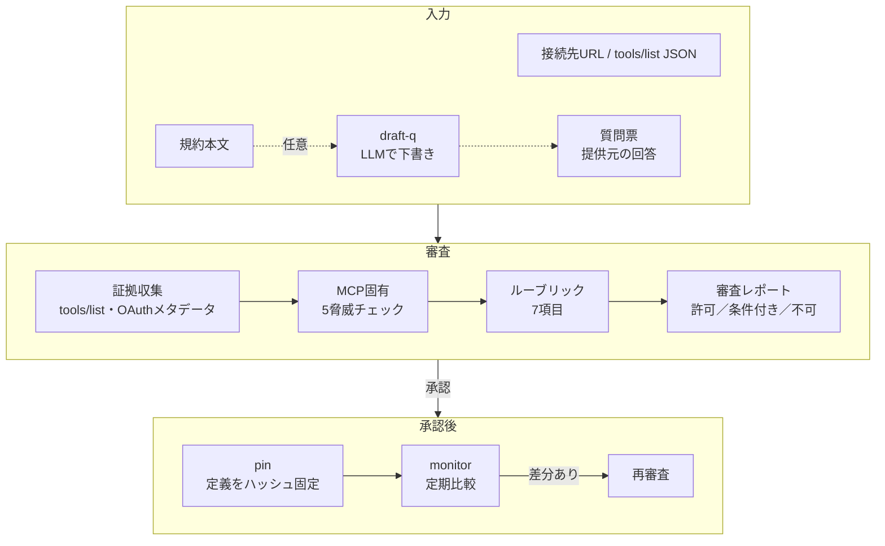

# mcp-gate — MCP接続先セキュリティ審査エージェント

**▶ ブラウザで試す：https://sanarita.github.io/mcp-gate/** （インストール不要・入力は外部に送信されません）

関連ツール：[IPI Guard Chat](https://github.com/sanarita/ipi-guard-chat)（文書の検査）／[skillscan](https://github.com/sanarita/skillscan)（スキルの検査）

Claude・Copilot などの生成AIを外部の MCP サーバ／API に接続してよいかを審査し、
**「許可／条件付き許可／不可」** の3段階で判定して、意思決定者にそのまま渡せる日本語レポートを出力します。
承認後はツール定義をハッシュで固定し、定期監視で「承認後の差し替え（ラグプル）」を検知します。

- Python 標準ライブラリのみ（追加インストール不要）、自動テスト32件
- 対象サーバのツールは**一度も実行しない**（取得するのは `tools/list` と OAuth メタデータだけ）
- IPI Guard / skillscan と同じ「パターン採点＋外部抽出器の差し込み口」設計

## 何を自動でやるか



### MCP固有の5脅威

| 脅威 | 判定方法 | 自動化 |
|---|---|---|
| ツールポイズニング | 説明文・スキーマ内の命令文、機密パス、秘匿指示、不可視文字、HTMLコメント等をパターン採点（日英） | 自動 |
| ラグプル | 承認時の定義を SHA-256 で固定し、追加・削除・変更をフィールド単位で差分表示 | 自動 |
| シャドーイング | 承認済み他サーバとのツール名衝突、他サーバのツール名への言及、上書き表現 | 自動 |
| 混乱した代理（トークン中継） | トークン中継・audience 検証・クライアントごとの同意 | 提供元回答（外から観測不可） |
| 過剰なOAuthスコープ | 広すぎるスコープ・不要スコープ・参照用途の書き込みスコープ、PKCE(S256)対応 | 自動＋回答 |

### 評価ルーブリック（7項目）

| # | 審査項目 | OWASP Agentic | OWASP LLM | 判定材料 |
|---|---|---|---|---|
| 1 | 運営主体の実在性 | ASI04 | LLM03 | 法人番号チェックデジット検証、ドメイン一致、人手確認フラグ |
| 2 | 認証方式 | ASI03 | LLM06 | HTTPS、OAuthメタデータ、PKCE、スコープ、トークン中継 |
| 3 | 送信されるデータの範囲 | ASI02, ASI03 | LLM02 | 機密区分の上限、書き込み系ツール、長さ無制限の自由記述引数 |
| 4 | データの保持・学習利用 | ASI04, ASI06 | LLM02 | 学習利用、保持日数、削除対応 |
| 5 | ホスティング地域 | ASI04 | LLM02 | 処理地域、再委託先の開示 |
| 6 | ツール定義の内容 | ASI01, ASI02, ASI04 | LLM01, LLM03 | 上記の5脅威チェック |
| 7 | 監査ログの有無 | ASI08, ASI10 | LLM06 | 提供元ログ、自社ゲートウェイでの記録 |

総合判定：NG が1つでもあれば **不可**／要対応・未確認があれば **条件付き許可**（条件を列挙）／すべて OK なら **許可**。

> ASI番号との対応は本ツールの設計上の割り当てで、OWASP 公式の対応表ではありません。

## 使い方

```powershell
# リポジトリのフォルダで実行（uv を使わない場合は uv run を外して python で実行）
uv run python -m mcpgate audit --snapshot samples\patent_clean.json -q samples\questionnaire_patent.json --inventory samples\inventory -o out\report.md
```

| コマンド | 内容 |
|---|---|
| `snapshot --url URL -o snap.json` | 接続先からツール定義とOAuthメタデータを取得して保存 |
| `audit (--url URL \| --snapshot F) -q 質問票 [--inventory DIR] [--pins DIR]` | 審査してレポート出力（`--json` で機械処理用） |
| `pin (--url \| --snapshot) --pins DIR --approved-by 名前` | 承認時点の定義を固定 |
| `monitor --targets targets.json --pins DIR` | 固定定義との差分監視 |
| `draft-q --policy 規約.txt --source URL` | 規約から質問票の下書きを作成（要 `ANTHROPIC_API_KEY`） |

トークンが必要な接続先は `--token-env 環境変数名` で渡します（値をコマンドラインやファイルに書かない）。

終了コード：`0` 正常 ／ `1` エラー ／ `2` 監視で変更検知 ／ `3` 審査結果が「不可」。CI やタスクスケジューラで分岐に使えます。

### 運用の流れ

1. `samples/questionnaire_template.json` をコピーし、提供元への質問票として回答を集める（規約があれば `draft-q` で下書き）
2. `audit` でレポートを作り、条件付きなら条件を満たしてから再度 `audit`
3. 承認したら `pin` で固定し、`pins/` をリポジトリにコミット
4. `examples/mcp-monitor.yml` を `.github/workflows/` に置くか、Windows タスクスケジューラで `monitor` を定期実行。差分が出たら再審査

### サンプル

| ファイル | 内容 | 期待判定 |
|---|---|---|
| `patent_clean.json` | 架空の特許検索MCP（参照系2ツール） | 許可（pin済みの場合） |
| `patent_poisoned.json` | 説明文に `~/.ssh` 読み取り・秘匿指示・BCC上書きを仕込んだ検体 | 不可 |
| `patent_rugpull.json` | 承認後に説明文を書き換え、`export_all` を追加した検体 | 不可（pin と比較時） |
| `inventory/corp-mail.json` | 承認済み社内メールMCP（シャドーイング検知の比較対象） | — |

## ブラウザ版（GitHub Pages）

インストール不要で、ブラウザから審査できる画面を `docs/index.html` に用意しています。

- **入力はすべてブラウザ内で処理**し、外部に送信しません。審査対象のサーバにもアクセスしません（ツール定義はJSONで読み込む）。
- 外部との通信は、解析エンジン Pyodide（cdn.jsdelivr.net）と Google Fonts の読み込みだけです。
- 審査ロジックはCLIと同じPythonコードを埋め込んで動かしています。通信を伴うモジュール（collect / cli / mcp_server / policy_agent）は含めていません。

公開URL：https://sanarita.github.io/mcp-gate/ （フォークして使う場合は Settings → Pages で `main` の `/docs` を指定）

### コードを変更したら

```powershell
python tools/build_web.py --repo sanarita/mcp-gate
```

で `docs/index.html` を作り直してコミットします。作り直し忘れは `test_bundle_is_in_sync_with_source` が検出します。

## Claude Desktop から使う（MCPサーバ）

mcp-gate 自体を MCP サーバとして Claude Desktop に登録すると、チャットで審査を依頼できます。

| ツール | 内容 |
|---|---|
| `audit_server` | 接続先を審査し、判定と理由を返す（読み取りのみ） |
| `pin_server` | 承認済みの定義を固定する（承認者を必須入力） |
| `monitor_servers` | 固定定義との差分を確認する |

### 登録手順（Windows）

1. `where python` で Python の**フルパス**を確認する（Claude Desktop は PATH を引き継がないことがあるため。`WindowsApps` 配下のパスはストアのエイリアスなので使わない）
2. Claude Desktop の設定から開発者向けの設定ファイル（`claude_desktop_config.json`）を開き、`claude_desktop_config.example.json` の内容を追記する。`<ユーザー名>` と Python のパスを置き換える
3. Claude Desktop を完全に終了して再起動し、ツール一覧に `mcp-gate` が出ることを確認する

### 使い方の例

> samples/patent_poisoned.json を samples/questionnaire_patent.json と samples/inventory で審査して、人間向けレポートを out/report.md に保存して

### Claude 向けの安全設計

- **Claude に返す結果は伏せ字。** 審査対象の悪意ある説明文の抜粋は返さず、ルールIDと場所（例：`search_patents.description`）だけを返します。抜粋そのものが Claude への間接プロンプトインジェクションになるのを防ぐためです。原文入りの人間向けレポートは `report_path` にファイルで保存します。
- **ファイルアクセスは `MCPGATE_HOME` 配下に限定。** それ以外のパスは拒否します。
- **審査対象のサーバは、承認されるまで Claude Desktop に登録しないこと。** mcp-gate は「接続前の関所」です。
- mcp-gate 自身のツール定義も、自分の審査を通ることをテストで確認しています（`test_self_audit`）。

> 社内PCで使う場合は、Claude Desktop へのローカルMCPサーバ追加と、外部サーバへのアクセスが社内ルール上問題ないか、情報システム部門に確認してください。

## 設計上の注意と限界

- **stdio 型（ローカル実行型）MCP は直接取得しません。** 未審査のコードを実行することになるためです。隔離環境で `tools/list` を書き出した JSON を `--snapshot` で渡してください。
- **パターン検知は網羅的ではありません。** 言い換えや多言語の命令はすり抜けます。`check_poisoning(extra_scanners=...)` に IPI Guard の抽出器や LLM 判定器を差し込めます。
- **`annotations`（readOnlyHint 等）は提供元の自己申告です。** 安全性の保証として扱いません。
- **トークン中継・audience 検証はサーバ内部の実装**のため、外部から観測できません。提供元の書面回答を根拠とし、未回答は「未確認」になります。
- `draft-q` は規約本文を LLM に渡す前にインジェクション検査を行い、**本文に実在しない引用を根拠とする回答は破棄**します。出力は下書きであり、人が原文と照合してください。
- 最終承認は人が行います。本ツールは判断材料の収集と整理を自動化するものです。

## 参考（一次情報）

- MCP Specification — Security Best Practices / Authorization（2025-11-25）
- RFC 9728 OAuth 2.0 Protected Resource Metadata ／ RFC 8414 Authorization Server Metadata ／ RFC 7636 PKCE
- OWASP Top 10 for Agentic Applications 2026（ASI01–ASI10）／ OWASP Top 10 for LLM Applications 2025

## テスト

```powershell
uv run python -m unittest discover -s tests -t .
```

模擬 MCP サーバ（Streamable HTTP・SSE応答・ページング・OAuthメタデータ）を立てた取得テストを含みます。
