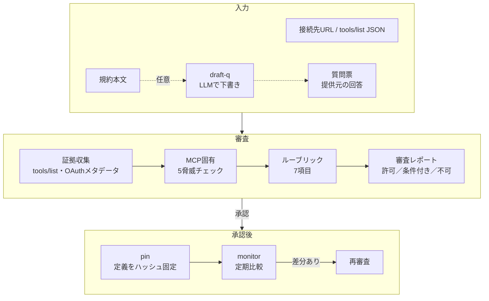

# maGATE — MCP・API接続先のセキュリティ審査ツール

**maGATE**（m＝MCP、a＝API）は、生成AIをMCPサーバやAPIにつなぐ**前に**、その接続先を審査する関門です。

**▶ ブラウザで試す：https://sanarita.github.io/magate/** （インストール不要・入力は外部に送信されません）

関連ツール：[IPI Guard Chat](https://github.com/sanarita/ipi-guard-chat)（文書の検査）／[skillscan](https://github.com/sanarita/skillscan)（スキルの検査）

Claude・Copilot などの生成AIを外部の MCP サーバ／API に接続してよいかを審査し、
**「許可／条件付き許可／不可」** の3段階で判定して、意思決定者にそのまま渡せる日本語レポートを出力します。
承認後はツール定義をハッシュで固定し、定期監視で「承認後の差し替え（ラグプル）」を検知します。

- MCPサーバに加え、APIの仕様書（OpenAPI 3.x／Swagger 2.0、Copilot Studioのカスタムコネクタを含む）も審査可能
- 判定はルールベース（LLMを使わない）。同じ入力なら必ず同じ結果になり、判定理由をたどれる
- Python 標準ライブラリのみ（追加インストール不要）、自動テスト135件
- 審査対象のツールやAPIは一度も実行しない（読むのは MCP のツール一覧・OAuth メタデータ・API 仕様書だけ）
- IPI Guard / skillscan と同じ「パターン採点＋外部抽出器の差し込み口」設計

## 他社のAPI・MCPにつなぐときのリスクと対応範囲

maGATE が受け持つのは、**接続前の審査と承認後の監視**です。それ以外のリスクは、他の対策と組み合わせて管理します。

| リスク | maGATEでの対応 | 他に必要な対策 |
|---|---|---|
| 接続先の定義に、AIへの命令が仕込まれている | ○ 接続前に検出 | — |
| 承認後に、接続先が定義を書き換える | ○ 承認時の定義を固定し、定期監視で検知 | 監視結果を誰が確認するかの決め |
| 送ったデータが学習に使われる・保存される・国外で処理される | △ 質問票で確認し、条件を明示 | 契約・利用規約での担保 |
| 必要以上の権限、書き込み・削除の操作がある | ○ 権限と操作を洗い出す | 接続設定で不要な操作を無効化 |
| 接続先から返ってくるデータに命令が混ざっている | × 対象外（maGATEは定義だけを見る） | 返却データの検査（[IPI Guard Chat](https://github.com/sanarita/ipi-guard-chat) など）、接続後の監視 |
| APIキーなどの認証情報が漏れる | △ 方式の指摘のみ | 保管場所とローテーションのルール |
| 利用者が申請せずに接続する | × 対象外 | 申請ルール、ゲートウェイでの接続先の制限 |

## 実在サーバの調査結果（2026年10月）

主要な公式リモートMCPサーバ18件に maGATE を実行し、認証まわりの実装を比較しました。
トークンを使わず、公開されている情報（OAuthメタデータ・ツール一覧）だけを取得しています。ツールは実行していません。

- 調査日：2026-10-12
- 対象一覧・取得データ：[research/2026-10-remote-mcp/](research/2026-10-remote-mcp/)
- メタデータは提供元が随時変更するため、結果は調査日時点のものです

### 1. PKCE(S256) の宣言

OAuth を使う15件のうち、**14件が認可サーバのメタデータで S256 を宣言**していました。

| 結果 | サーバ |
|---|---|
| S256 のみ | Airtable, Atlassian, Box, Cloudflare Observability, GitHub, Hugging Face, Linear, Notion, Sentry, Stripe, Vercel |
| S256 ＋ plain | Asana, Supabase |
| 宣言なし | Microsoft MCP Server for Enterprise（プレビュー） |

- Microsoft の認可サーバ（Entra ID）は PKCE 自体には対応していますが、メタデータに `code_challenge_methods_supported` がありません。MCP 認可仕様では、この項目がない場合クライアントは接続を拒否しなければならないため、maGATE は「不可」と判定します。社内ゲートウェイでメタデータを補う構成なら改善できます。
- 同サーバでは、指定された認可サーバ（`…/organizations/v2.0`）と、メタデータの `issuer`（`…/{tenantid}/v2.0`）が一致しないことも確認しました（Entra ID のマルチテナント窓口の既知の挙動）。
- `plain` は PKCE の弱い方式です。併記されている場合、maGATE は「要対応」としてクライアント側で S256 を使う設定かの確認を求めます。

### 2. スコープ設計

PKCE はほぼ全社が満たしていました。**実際に差がつくのは「権限をどこまで絞れるか」**です。

| 設計 | サーバ | 接続時の判断 |
|---|---|---|
| 細かく分かれている | Airtable, Atlassian, Supabase | 業務に必要な読み取りスコープだけで接続できる |
| 読み・書きの2択 | Linear | 参照用途なら `read` のみに絞る |
| 広い権限を含む | GitHub（`repo`）, Sentry（`project:write` を含む） | 読み取り専用の接続方法や不要スコープの除外を検討する |
| 1種類のみ | Stripe（`mcp`）, Notion・Asana（`default`） | スコープで権限を絞れないため、ツール単位の無効化などで補う |
| ログイン用のみ・宣言なし | Vercel, Box, Cloudflare Observability | 権限は提供元の管理画面側の設定で決まる |
| Graph 由来の `*.Read.All` | Microsoft MCP Server for Enterprise | テナント全体の読み取り権限。付与するスコープを最小限にする |

「接続してよいか」だけでなく、「**どの権限で接続するか**」を審査の論点にすることを推奨します。

### 3. ブラウザ版「URLから取得」の対応状況（CORS）

| 結果 | 件数 | サーバ |
|---|---|---|
| 取得できる | 3 | Microsoft Learn, DeepWiki, Hugging Face |
| 接続できるが、ツール一覧には認証が必要 | 6 | GitHub（通常・読み取り専用）, Atlassian, Notion, Linear, Asana |
| ブラウザからの接続を許可していない | 9 | Box, Microsoft Enterprise, Sentry, Stripe, Supabase, Vercel, Airtable, Cloudflare（2件） |

**CORS で「不可」はセキュリティが低いという意味ではありません。** 知らない Web サイトからの接続を受け付けない設定であり、むしろ守りが固いとも言えます。これらのサーバはコマンドライン版の `snapshot` で取得できます（今回の調査も CLI で全件取得）。

### この調査で行った maGATE の改善

- 認可サーバのメタデータ取得で、OpenID Connect の「発行元URLの末尾に付ける」形式（Entra ID などが採用）に対応しました。従来はこの形式を探索しておらず、Microsoft の認可サーバ情報を取得できていませんでした。
- PKCE の `plain` 方式が S256 と併記されている場合に警告するようにしました。
- いずれも再現用の模擬サーバを使った自動テストを追加しています（計83件）。

## 何を自動でやるか



### MCP固有の5脅威

| 脅威 | 判定方法 | 自動化 |
|---|---|---|
| ツールポイズニング | 説明文・スキーマ内の命令文、機密パス、秘匿指示、不可視文字、HTMLコメント等をパターン採点（日英） | 自動 |
| ラグプル | 承認時の定義を SHA-256 で固定し、追加・削除・変更をフィールド単位で差分表示 | 自動 |
| シャドーイング | 承認済み他サーバとのツール名衝突、他サーバのツール名への言及、上書き表現 | 自動 |
| 混乱した代理（トークン中継） | トークン中継・audience 検証・クライアントごとの同意 | 提供元回答（外から観測不可） |
| 過剰なOAuthスコープ | 広すぎるスコープ・不要スコープ・参照用途の書き込みスコープ、PKCE(S256)対応 | 自動＋回答 |

### 評価ルーブリック（7項目＋任意1項目）

| # | 審査項目 | OWASP Agentic | OWASP LLM | 判定材料 |
|---|---|---|---|---|
| 1 | 運営主体の実在性 | ASI04 | LLM03 | 法人番号チェックデジット検証、ドメイン一致、人手確認フラグ |
| 2 | 認証方式 | ASI03 | LLM06 | HTTPS、OAuthメタデータ、PKCE、スコープ、トークン中継 |
| 3 | 送信されるデータの範囲 | ASI02, ASI03 | LLM02 | 機密区分の上限、書き込み系ツール、長さ無制限の自由記述引数 |
| 4 | データの保持・学習利用 | ASI04, ASI06 | LLM02 | 学習利用、保持日数、削除対応 |
| 5 | ホスティング地域 | ASI04 | LLM02 | 処理地域、再委託先の開示 |
| 6 | ツール定義の内容 | ASI01, ASI02, ASI04 | LLM01, LLM03 | 上記の5脅威チェック |
| 7 | 監査ログの有無 | ASI08, ASI10 | LLM06 | 提供元ログ、自社ゲートウェイでの記録 |
| 8 | 既知脆弱性・実行環境（任意） | ASI04 | LLM03 | 配布パッケージと依存ライブラリの既知脆弱性（OSV）、Node.jsの対応版数、応答ヘッダーのPHP版数 |

8項目めは `--package` / `--lockfile` を指定したとき、または接続先が応答ヘッダーで実行環境の版数を名乗ったときだけ評価します（指定しない従来の審査結果は変わりません）。

総合判定：NG が1つでもあれば **不可**／要対応・未確認があれば **条件付き許可**（条件を列挙）／すべて OK なら **許可**。

> ASI番号との対応は本ツールの設計上の割り当てで、OWASP 公式の対応表ではありません。

### 既知脆弱性・実行環境のチェック（v0.7.0）

2026年10月の Node2Shell（CVE-2026-111497）では、**接続先が細工したレスポンスを返すだけで、接続する側のNode.jsが攻撃され得る**ことが示されました。
MCPサーバの多くは Node.js で動き、外部から取得したデータを解凍します。そこで、接続先の「定義」に加えて「中身の部品」も審査対象にしました。

| 見るもの | 判定 |
|---|---|
| 配布パッケージ・依存ライブラリの既知脆弱性（OSV） | 重大度 CRITICAL／HIGH → NG、それ以外 → 要対応（修正版への更新を条件にする） |
| 悪用確認済みの脆弱性（`--exploited` の一覧に該当） | 重大度に関係なく NG。CISA KEV 掲載前の情報も手で足せる |
| `engines.node`（パッケージが宣言する対応版数） | サポート終了・修正版なしの系列を許す → 要対応、宣言なし → 未確認 |
| 応答ヘッダー `X-Powered-By: PHP/x.y.z` | 修正前・サポート終了の版数 → NG（PHP2Shell）。版数の公開自体も要対応 |

```powershell
# 配布パッケージ（stdio型のMCPサーバも、コードを実行せずに審査できる）
uv run python -m magate audit --snapshot snap.json -q 質問票.json --package npm:@playwright/mcp
# 依存ライブラリまで照会し、悪用確認済みの一覧も使う
uv run python -m magate audit --snapshot snap.json -q 質問票.json --package npm:mcp-sample@1.2.3 --lockfile package-lock.json --exploited exploited.txt
```

- 照会結果はスナップショットの `supply_chain` に取得日時つきで保存し、判定はそれだけを見ます。**同じスナップショットなら同じ結果**という性質は変わりません。
- パッケージのインストールや実行はしません。読むのはnpmレジストリのメタデータとOSVだけです。
- ランタイムの修正版数は `magate/runtimes.py` の表で管理します（確認日つき）。新しい脆弱性が出たら表を更新します。
- 応答ヘッダーは自己申告です。版数を隠している接続先を「安全」とはみなしません。
- 社外の接続先に攻撃用のデータを送って確かめる検査（能動的な検査）は行いません。

## 使い方

```powershell
# リポジトリのフォルダで実行（uv を使わない場合は uv run を外して python で実行）
uv run python -m magate audit --snapshot samples\patent_clean.json -q samples\questionnaire_patent.json --inventory samples\inventory -o out\report.md
```

| コマンド | 内容 |
|---|---|
| `snapshot --url URL -o snap.json` | 接続先からツール定義とOAuthメタデータを取得して保存 |
| `audit (--url URL \| --snapshot F) -q 質問票 [--inventory DIR] [--pins DIR]` | 審査してレポート出力（`--json` で機械処理用） |
| `audit ... --package npm:名前@版 [--lockfile F] [--exploited F]` | 既知脆弱性・実行環境のチェックを加えて審査（v0.7.0） |
| `pin (--url \| --snapshot) --pins DIR --approved-by 名前` | 承認時点の定義を固定 |
| `monitor --targets targets.json --pins DIR` | 固定定義との差分監視 |
| `draft-q --policy 規約.txt --source URL` | 規約から質問票の下書きを作成（要 `ANTHROPIC_API_KEY`） |
| `cors-check --targets URL一覧.json` | ブラウザ版の「URLから取得」が使えるか（CORS）を、ブラウザと同じ手順で調べる |

社内・ローカルのMCPサーバを審査するときは `--allow-private` を付けます（例：`python -m magate --allow-private audit --url http://10.0.0.5/mcp ...`）。既定では、公開されていないアドレスへは接続しません。

トークンが必要な接続先は `--token-env 環境変数名` で渡します（値をコマンドラインやファイルに書かない）。

終了コード：`0` 正常 ／ `1` エラー ／ `2` 監視で変更検知 ／ `3` 審査結果が「不可」。CI やタスクスケジューラで分岐に使えます。

### 運用の流れ

1. `samples/questionnaire_template.json` をコピーし、提供元への質問票として回答を集める（規約があれば `draft-q` で下書き）
2. `audit` でレポートを作り、条件付きなら条件を満たしてから再度 `audit`
3. 承認したら `pin` で固定し、`pins/` をリポジトリにコミット
4. `examples/mcp-monitor.yml` を `.github/workflows/` に置くか、Windows タスクスケジューラで `monitor` を定期実行。差分が出たら再審査

### サンプル

| ファイル | 内容 | 期待判定 |
|---|---|---|
| `patent_clean.json` | 架空の特許検索MCP（参照系2ツール） | 許可（pin済みの場合） |
| `patent_poisoned.json` | 説明文に `~/.ssh` 読み取り・秘匿指示・BCC上書きを仕込んだ検体 | 不可 |
| `patent_rugpull.json` | 承認後に説明文を書き換え、`export_all` を追加した検体 | 不可（pin と比較時） |
| `inventory/corp-mail.json` | 承認済み社内メールMCP（シャドーイング検知の比較対象） | — |

## ブラウザ版（GitHub Pages）

インストール不要で、ブラウザから審査できる画面を `docs/index.html` に用意しています。

- **入力はすべてブラウザ内で処理**し、外部に送信しません。ツール名・説明文の貼り付け、tools/list や OpenAPI の JSON 読み込みで審査できます。
- 「URLから取得（試験的）」を押したときだけ、**利用者のブラウザから直接**接続先へ接続し、ツール一覧を取得します（中継サーバは使いません）。接続先がブラウザからの接続（CORS）を許可していない場合は取得できないため、CLI の `snapshot` を使います。
- 外部との通信は、解析エンジン Pyodide（cdn.jsdelivr.net）と Google Fonts の読み込みだけです。
- 審査ロジックはCLIと同じPythonコードを埋め込んで動かしています。通信を伴うモジュール（collect / cli / mcp_server / policy_agent）は含めていません。

公開URL：https://sanarita.github.io/magate/ （フォークして使う場合は Settings → Pages で `main` の `/docs` を指定）

### コードを変更したら

```powershell
python tools/build_web.py --repo sanarita/magate
```

で `docs/index.html` を作り直してコミットします。作り直し忘れは `test_bundle_is_in_sync_with_source` が検出します。

## Claude Desktop から使う（MCPサーバ）

maGATE 自体を MCP サーバとして Claude Desktop に登録すると、チャットで審査を依頼できます。

| ツール | 内容 |
|---|---|
| `audit_server` | 接続先を審査し、判定と理由を返す（読み取りのみ） |
| `pin_server` | 承認済みの定義を固定する（承認者を必須入力） |
| `monitor_servers` | 固定定義との差分を確認する |

### 登録手順（Windows）

1. `where python` で Python の**フルパス**を確認する（Claude Desktop は PATH を引き継がないことがあるため。`WindowsApps` 配下のパスはストアのエイリアスなので使わない）
2. Claude Desktop の設定から開発者向けの設定ファイル（`claude_desktop_config.json`）を開き、`claude_desktop_config.example.json` の内容を追記する。`<ユーザー名>` と Python のパスを置き換える
3. Claude Desktop を完全に終了して再起動し、ツール一覧に `maGATE` が出ることを確認する

### 使い方の例

> samples/patent_poisoned.json を samples/questionnaire_patent.json と samples/inventory で審査して、人間向けレポートを out/report.md に保存して

### Claude 向けの安全設計

- **Claude に返す結果は伏せ字。** 審査対象の悪意ある説明文の抜粋は返さず、ルールIDと場所（例：`search_patents.description`）だけを返します。抜粋そのものが Claude への間接プロンプトインジェクションになるのを防ぐためです。原文入りの人間向けレポートは `report_path` にファイルで保存します。
- **ファイルアクセスは `MAGATE_HOME` 配下に限定。** それ以外のパスは拒否します。
- **審査対象のサーバは、承認されるまで Claude Desktop に登録しないこと。** maGATE は「接続前の関所」です。
- maGATE 自身のツール定義も、自分の審査を通ることをテストで確認しています（`test_self_audit`）。

> 社内PCで使う場合は、Claude Desktop へのローカルMCPサーバ追加と、外部サーバへのアクセスが社内ルール上問題ないか、情報システム部門に確認してください。

## Azure API Center との連携

Azure API Center を MCP サーバ・API の社内台帳として使い、maGATE の判定・許可条件・審査日・OWASP Agentic 該当項目を、各接続先のメタデータとして記録できます。
台帳を見れば「この接続先はどういう条件なら使ってよいか」が誰にでも分かる状態にします。

```powershell
python integrations/azure-api-center/writeback.py --api-id microsoft-learn-mcp-server --url https://learn.microsoft.com/api/mcp
```

Azure Functions に配備すると、利用者が API Center に接続先を登録するだけで、定期的に自動で審査・記録されます。
準備手順と仕組みは [integrations/azure-api-center/](integrations/azure-api-center/) を参照してください。

## 設計上の注意と限界

- **maGATE 自身が踏み台にならないよう、通信に関所を設けています（v0.7.1）。** 名前解決の結果が公開されていないアドレス（プライベート・ループバック・リンクローカル・`169.254.169.254` などのクラウド管理用エンドポイント）なら接続しません。リダイレクト先も同じく確認し、HTTPS から HTTP への格下げは辿りません。接続先の応答に書かれた URL（認可サーバのメタデータなど）は HTTPS のときだけ辿ります。応答は 5MB までしか読みません。社内の MCP サーバを審査するときだけ `--allow-private`（または環境変数 `MAGATE_ALLOW_PRIVATE=1`）で許可します。名前解決と接続の間でアドレスをすり替える攻撃（DNSリバインディング）は標準ライブラリでは完全に防げないため、社内ネットワークに届く場所で動かす場合はネットワーク側でも送信先を制限してください。
- **stdio 型（ローカル実行型）MCP は直接取得しません。** 未審査のコードを実行することになるためです。隔離環境で `tools/list` を書き出した JSON を `--snapshot` で渡してください。
- **パターン検知は網羅的ではありません。** 言い換えや多言語の命令はすり抜けます。`check_poisoning(extra_scanners=...)` に IPI Guard の抽出器や LLM 判定器を差し込めます。
- **`annotations`（readOnlyHint 等）は提供元の自己申告です。** 安全性の保証として扱いません。
- **トークン中継・audience 検証はサーバ内部の実装**のため、外部から観測できません。提供元の書面回答を根拠とし、未回答は「未確認」になります。
- `draft-q` は規約本文を LLM に渡す前にインジェクション検査を行い、**本文に実在しない引用を根拠とする回答は破棄**します。出力は下書きであり、人が原文と照合してください。
- 最終承認は人が行います。本ツールは判断材料の収集と整理を自動化するものです。

## 参考（一次情報）

- MCP Specification — Security Best Practices / Authorization（2025-11-25）
- RFC 9728 OAuth 2.0 Protected Resource Metadata ／ RFC 8414 Authorization Server Metadata ／ RFC 7636 PKCE
- OWASP Top 10 for Agentic Applications 2026（ASI01–ASI10）／ OWASP Top 10 for LLM Applications 2025

## テスト

```powershell
uv run python -m unittest discover -s tests -t .
```

模擬 MCP サーバ（Streamable HTTP・SSE応答・ページング・OAuthメタデータ）を立てた取得テストを含みます。
既知脆弱性のテストは OSV・npmレジストリも模擬サーバで代用し、ネットワークに出ません。

## 名称について

maGATE は v0.4.0 で `mcp-gate` から改名しました。接続後の MCP 通信を制御するゲートウェイ「mcpgate」（別プロジェクト）とは異なるツールです。maGATE は、接続を許可する**前**の審査を行います。

## 他ツールとの関係

生成AIとMCP・APIまわりのセキュリティ対策は、大きく次の系統に分かれます。

| 系統 | 役割 | 使うタイミング |
|---|---|---|
| 審査（maGATE） | 接続してよいかを判断する | 接続の前 |
| ゲートウェイ | 実際のツール呼び出しを許可・拒否・記録する | 接続の後 |
| ローカルスキャナ | 開発者のPCにすでに入っているMCPを点検する | 定期的な棚卸し |
| API自体の防御 | 自社APIへの不正アクセスを防ぐ（OWASP API Security Top 10） | APIの設計・運用 |

maGATE は「接続の前」に特化しています。審査で許可した接続先だけをゲートウェイに登録する、という組み合わせで使うことを想定しています。
攻撃者が自社のAPIを直接呼び出すような攻撃は、maGATEの対象外です。ただし、自社のAPIをCopilot StudioのコネクタやMCP経由でAIに使わせる場合は、maGATEでAPI仕様書を審査することで、AIに渡すと危険な操作（書き込み・削除）や広すぎる権限を事前に洗い出せます。

