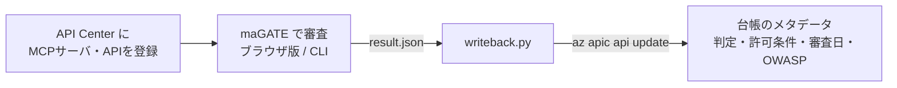
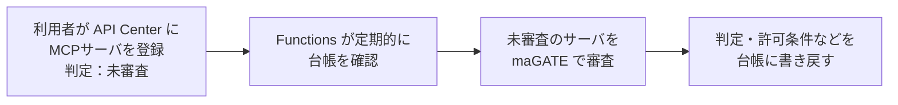

# Azure API Center 連携

Azure API Center を MCP サーバ・API の**社内台帳（プライベートレジストリ）**として使い、
maGATE の審査結果を各接続先のカスタムメタデータとして記録します。

API Center は「どの接続先があるか」を一元管理できますが、「その接続先に生成AIをつないで安全か」を判定する機能はありません。
この連携で、台帳を見れば**判定と、どういう条件なら使ってよいか**が誰にでも分かる状態にします。



## 台帳に記録する項目

| メタデータ名 | 表示名 | 内容 |
|---|---|---|
| `magate-target-url` | 審査対象URL | 審査する MCP サーバの URL（登録時に入力。自動審査で使う） |
| `magate-verdict` | maGATE判定 | 許可／条件付き許可／不可／未審査 |
| `magate-conditions` | maGATE許可条件 | 許可の条件（不可の場合は不可の理由）を番号付きで連結 |
| `magate-reviewed-at` | maGATE審査日 | 台帳に書き戻した日（YYYY-MM-DD） |
| `magate-owasp` | OWASP Agentic該当項目 | NG・要対応・未確認になった審査項目の OWASP Agentic 番号を、状態ごとに記録（例：`要対応: ASI03, ASI04 / 未確認: ASI02, ASI03`） |

いずれも必須にはしません。必須にすると、審査前の接続先を台帳に登録できなくなるためです（登録時は「未審査」を選ぶ）。

## 準備（初回のみ）

Azure CLI でログインし、API Center を作成してメタデータを定義します。リソース名は例です。

```powershell
az provider register --namespace Microsoft.ApiCenter
az group create -n magate-rg -l eastus
az apic create -g magate-rg -n magate-apic -l eastus   # Free プラン

cd integrations/azure-api-center/metadata
az apic metadata create -g magate-rg -n magate-apic --metadata-name "magate-verdict"     --schema '@verdict.json'    --assignments '@assign.json'
az apic metadata create -g magate-rg -n magate-apic --metadata-name "magate-conditions"  --schema '@conditions.json' --assignments '@assign.json'
az apic metadata create -g magate-rg -n magate-apic --metadata-name "magate-reviewed-at" --schema '@reviewed.json'   --assignments '@assign.json'
az apic metadata create -g magate-rg -n magate-apic --metadata-name "magate-owasp"       --schema '@owasp.json'      --assignments '@assign.json'
az apic metadata create -g magate-rg -n magate-apic --metadata-name "magate-target-url"  --schema '@target-url.json' --assignments '@assign.json'
```

PowerShell では `@` が特殊文字なので、`'@verdict.json'` のようにシングルクォートで囲みます。

接続先の登録は Azure Portal の API Center で「資産の登録 > MCP サーバー」から行います。
登録時に、カスタムメタデータの「審査対象URL」に接続先のURLを、「maGATE判定」に「未審査」を入力します。
Portal の登録画面で入力するランタイムURLは、2026年10月時点で API（2024-03-01 / 2024-06-01-preview）から読み取れる場所に保存されないことを確認したため、審査用のURLは専用の欄に持たせています。

## 使い方

**ブラウザ版で審査した場合**：審査後に「結果を保存（.json）」で保存したファイルを渡します。

```powershell
python integrations/azure-api-center/writeback.py --api-id microsoft-learn-mcp-server --result "Microsoft Learn MCP Server-result.json"
```

**CLI で審査と書き戻しをまとめて行う場合**：

```powershell
python integrations/azure-api-center/writeback.py --api-id microsoft-learn-mcp-server --url https://learn.microsoft.com/api/mcp
```

`--dry-run` を付けると、台帳には書き込まずに、書き込む値とコマンドだけを表示します。
リソースグループ名・API Center 名が既定値（`magate-rg` / `magate-apic`）と異なる場合は `-g` / `-n` で指定します。

## 実装上の注意

- `az apic api update` の `--custom-properties` はファイル指定（`@file`）に対応していないため、Azure CLI の省略記法で値を渡しています。
- 同オプションは既存のメタデータを丸ごと置き換えるため、writeback.py は書き込む前に現在の値を読み出し、審査対象URLなど他の項目を残したまま差し替えます。値はシングルクォートで囲むので、`,` や `:` を含む条件文もそのまま記録できます。
- 2026年10月時点の apic-extension（GA版）は `az apic api create --type` に `mcp` を指定できません。MCP サーバの登録は Portal で行い、メタデータの更新には種別を変更しない `update` を使っています。
- 「未確認」も記録します。未確認は問題なしではなく、リスクを否定できていない状態のため、台帳から見えるようにしています。
- 判定はルールベースのため、リスクスコアは記録しません（maGATE は判定理由をたどれる設計で、数値スコアを持たない）。

## Azure Functions で自動審査する

`function_app/` を Azure Functions に配備すると、利用者は API Center に接続先を登録するだけで、審査と台帳への記録が自動で行われます。



- 対象は、種別が MCP で、判定が空欄または「未審査」の資産です。審査には「審査対象URL」を使います（未入力でデプロイにランタイムURLがあれば、それを使う）。審査済みの資産は上書きしません（再審査したいときは判定を「未審査」に戻す）。
- 接続先の取得に失敗した場合（認証が必要など）は、判定を「未審査」のまま、許可条件の欄に理由を記録します。同じ日には再試行しません。
- 台帳の読み書きは Functions のマネージドIDで行います。個人の資格情報は使いません。
- 審査日は日本時間で記録します（Azure 上の時計は UTC のため変換。アプリ設定 `MAGATE_TZ` で変更可）。
- **審査対象URLは、接続先を登録した人が決める値です。** Functions が社内や Azure 内部への踏み台（SSRF）にならないよう、maGATE は既定で、公開されていないアドレス（プライベート・ループバック・リンクローカル・`169.254.169.254` など）への接続、メタデータに書かれた HTTP の URL、HTTPS から HTTP へのリダイレクトを拒否します（v0.7.1）。社内の MCP サーバも審査したい場合だけ、アプリ設定 `MAGATE_ALLOW_PRIVATE=1` を明示的に追加してください。その場合は、API Center に登録できる人を絞ることと、Functions の送信先をネットワーク側でも制限することをあわせて検討してください。
- 登録時に即時ではなく定期確認にしているのは、API Center の Event Grid イベントが API 定義の追加・更新時にしか発生せず、Portal で登録した MCP サーバでは発生しないためです。

### 0. 事前確認（手元のPC）

管理用 REST API のバージョンは、手元の Azure CLI が実際に使っているものに合わせます。

```powershell
az apic api show -g magate-rg -n magate-apic --api-id microsoft-learn-mcp-server --debug 2>&1 | Select-String "api-version=" | Select-Object -First 1
```

表示された URL の `api-version=` の値を控えます。続けて、手元で動作確認します（台帳には書き込みません）。

```powershell
$env:AZURE_SUBSCRIPTION_ID = az account show --query id -o tsv
$env:APIC_API_VERSION = "<控えた値>"
uv run --with azure-identity python integrations/azure-api-center/function_app/reviewer.py --dry-run
```

### 1. 配備

名前は例です。関数アプリ名は世界で一意、ストレージ名は英小文字と数字のみ（3〜24文字）にします。
新しい PowerShell ウィンドウでは環境変数が消えているため、最初に設定し直します。

```powershell
$env:AZURE_SUBSCRIPTION_ID = az account show --query id -o tsv
$APP = "magate-func-sanarita"
$ST  = "magatefunc20261021"

# 新しいサブスクリプションでは、利用するサービスの登録が必要（すべて Registered になるまで待つ）
az provider register --namespace Microsoft.Web
az provider register --namespace Microsoft.Storage
az provider register --namespace Microsoft.Insights
az provider register --namespace Microsoft.OperationalInsights
az provider show -n Microsoft.Storage --query registrationState -o tsv

# 関数アプリが使うストレージ（最小 TLS を 1.2 に引き上げる。既定は 1.0）
az storage account create -n $ST -g magate-rg -l eastus --sku Standard_LRS --allow-blob-public-access false
az storage account update -n $ST -g magate-rg --min-tls-version TLS1_2
$STID = az storage account show -n $ST -g magate-rg --query id -o tsv

# 関数アプリ（Flex Consumption）。専用のリソースグループに作る
az group create -n magate-func-rg -l eastus
az functionapp create -g magate-func-rg -n $APP --storage-account $STID --flexconsumption-location eastus2 --runtime python --runtime-version 3.12
az functionapp update -g magate-func-rg -n $APP --set httpsOnly=true

# マネージドIDを有効にし、API Center だけに書き込み権限を付ける
$PRINCIPAL = az functionapp identity assign -g magate-func-rg -n $APP --query principalId -o tsv
$APIC = az apic show -g magate-rg -n magate-apic --query id -o tsv
az role assignment create --assignee-object-id $PRINCIPAL --assignee-principal-type ServicePrincipal --role Contributor --scope $APIC
az role assignment list --assignee $PRINCIPAL --all -o table

# 設定（実行間隔は15分ごと、審査日は日本時間）
az functionapp config appsettings set -g magate-func-rg -n $APP --settings AZURE_SUBSCRIPTION_ID=$env:AZURE_SUBSCRIPTION_ID APIC_RESOURCE_GROUP=magate-rg APIC_SERVICE_NAME=magate-apic APIC_API_VERSION=2024-03-01 "MAGATE_SCHEDULE=0 */15 * * * *" MAGATE_TZ=Asia/Tokyo

# maGATE 本体をコピーして配備（Azure Functions Core Tools が必要：winget install Microsoft.Azure.FunctionsCoreTools）
python integrations/azure-api-center/function_app/prepare.py
cd integrations/azure-api-center/function_app
func azure functionapp publish $APP --python
cd ..\..\..
```

最後に `Functions in magate-func-sanarita:` の下に `magate_review - [timerTrigger]` と表示されれば配備完了です。

#### 構築時に遭遇したことと対処（2026年10月）

| 事象 | 原因と対処 |
|---|---|
| ストレージ作成で `SubscriptionNotFound` | サービス（Microsoft.Storage）の登録が処理中だった。`Registered` になるのを待って再実行 |
| 関数アプリ作成で `Cannot acquire exclusive lock to create or update this server farm` が繰り返し発生 | 新しいサブスクリプションの eastus で解消しなかった。専用のリソースグループに分け、リージョンを eastus2 にして作成できた。API Center とは REST API で通信するため、リージョンが違っても動作に影響はない |
| 作成直後の `httpsOnly` が false、ストレージの最小 TLS が 1.0 | 既定値のまま使わず、HTTPS のみ・TLS 1.2 に変更（関数はタイマー起動のみで外部からの呼び出し口はないが、許可しておく理由がないため） |
| `az functionapp config appsettings set` の結果で値が `null` と表示される | Azure CLI が秘密情報を出さないよう値を伏せて表示する仕様。設定自体は反映されている |
| 配備時に「手元の Python 3.13 と Azure の 3.12 が違う」と警告 | ライブラリは Azure 側（3.12）でインストールされる（remote build）ため、問題なし |
| Portal の MCP サーバ登録で入力したランタイムURLが、API から読めない | デプロイ・環境のどちらにも保存されていなかった（API 2024-03-01 / 2024-06-01-preview で確認）。審査用のURLは専用のメタデータ欄（審査対象URL）に持たせた |

### 2. 動作確認

Portal で資産を登録し、「審査対象URL」にURLを、「maGATE判定」に「未審査」を入力して、次の実行（最大15分後）を待つか、Portal の関数アプリ「関数 > magate_review」の「テストと実行」から手動で実行します。
審査済みの資産を再審査する場合は、判定を「未審査」に戻します。CLI で戻すときは、`az apic api update --custom-properties` が既存の値を丸ごと置き換えるため、審査対象URLも一緒に指定します。

```powershell
az apic api update -g magate-rg -n magate-apic --api-id microsoft-learn-mcp-server --custom-properties "{magate-verdict:'未審査',magate-target-url:'https://learn.microsoft.com/api/mcp'}"
az apic api show -g magate-rg -n magate-apic --api-id microsoft-learn-mcp-server --query customProperties
```
実行ログは関数アプリの「ログ」または Application Insights で確認できます。

### 費用の目安

Flex Consumption プランは実行した分だけの課金で、15分ごとの実行程度なら無料枠内に収まる想定です。
ストレージアカウントと Application Insights に少額の費用がかかる場合があるため、予算アラートを設定しておくことを推奨します。
