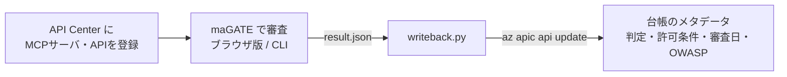

# Azure API Center 連携

Azure API Center を MCP サーバ・API の**社内台帳（プライベートレジストリ）**として使い、
maGATE の審査結果を各接続先のカスタムメタデータとして記録します。

API Center は「どの接続先があるか」を一元管理できますが、「その接続先に生成AIをつないで安全か」を判定する機能はありません。
この連携で、台帳を見れば**判定と、どういう条件なら使ってよいか**が誰にでも分かる状態にします。



## 台帳に記録する項目

| メタデータ名 | 表示名 | 内容 |
|---|---|---|
| `magate-verdict` | maGATE判定 | 許可／条件付き許可／不可／未審査 |
| `magate-conditions` | maGATE許可条件 | 許可の条件（不可の場合は不可の理由）を番号付きで連結 |
| `magate-reviewed-at` | maGATE審査日 | 台帳に書き戻した日（YYYY-MM-DD） |
| `magate-owasp` | OWASP Agentic該当項目 | 要対応・NG になった審査項目の OWASP Agentic 番号 |

いずれも必須にはしません。必須にすると、審査前の接続先を台帳に登録できなくなるためです（登録時は「未審査」を選ぶ）。

## 準備（初回のみ）

Azure CLI でログインし、API Center を作成してメタデータを定義します。リソース名は例です。

```powershell
az provider register --namespace Microsoft.ApiCenter
az group create -n magate-rg -l eastus
az apic create -g magate-rg -n magate-apic -l eastus   # Free プラン

cd integrations/azure-api-center/metadata
az apic metadata create -g magate-rg -n magate-apic --metadata-name "magate-verdict"     --schema '@verdict.json'    --assignments '@assign.json'
az apic metadata create -g magate-rg -n magate-apic --metadata-name "magate-conditions"  --schema '@conditions.json' --assignments '@assign.json'
az apic metadata create -g magate-rg -n magate-apic --metadata-name "magate-reviewed-at" --schema '@reviewed.json'   --assignments '@assign.json'
az apic metadata create -g magate-rg -n magate-apic --metadata-name "magate-owasp"       --schema '@owasp.json'      --assignments '@assign.json'
```

PowerShell では `@` が特殊文字なので、`'@verdict.json'` のようにシングルクォートで囲みます。

接続先の登録は Azure Portal の API Center で「資産の登録 > MCP サーバー」から行います（ランタイムURLに接続先のURLを入力）。

## 使い方

**ブラウザ版で審査した場合**：審査後に「結果を保存（.json）」で保存したファイルを渡します。

```powershell
python integrations/azure-api-center/writeback.py --api-id microsoft-learn-mcp-server --result "Microsoft Learn MCP Server-result.json"
```

**CLI で審査と書き戻しをまとめて行う場合**：

```powershell
python integrations/azure-api-center/writeback.py --api-id microsoft-learn-mcp-server --url https://learn.microsoft.com/api/mcp
```

`--dry-run` を付けると、台帳には書き込まずに、書き込む値とコマンドだけを表示します。
リソースグループ名・API Center 名が既定値（`magate-rg` / `magate-apic`）と異なる場合は `-g` / `-n` で指定します。

## 実装上の注意

- `az apic api update` の `--custom-properties` はファイル指定（`@file`）に対応していないため、Azure CLI の省略記法で値を渡しています。値はシングルクォートで囲むので、`,` や `:` を含む条件文もそのまま記録できます。
- 2026年10月時点の apic-extension（GA版）は `az apic api create --type` に `mcp` を指定できません。MCP サーバの登録は Portal で行い、メタデータの更新には種別を変更しない `update` を使っています。
- 判定はルールベースのため、リスクスコアは記録しません（maGATE は判定理由をたどれる設計で、数値スコアを持たない）。
